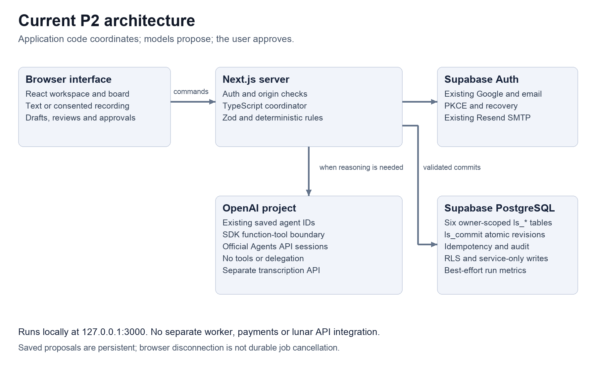
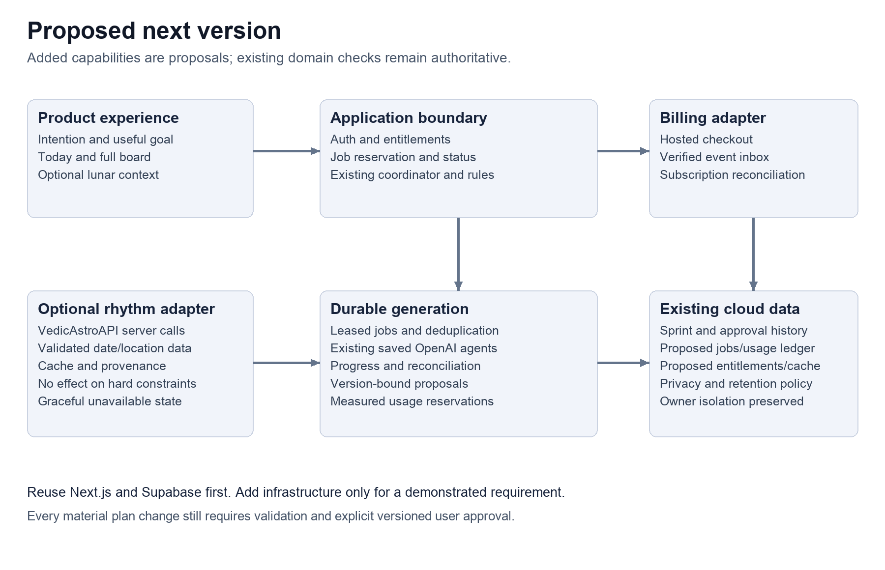

# LunarSprints Architecture and Next Version Blueprint

Verified P2 baseline • 31 October 2026

A technical handoff and product development plan for the founder and the next implementation team

## 1 Read this first

LunarSprints is a working AI-assisted planning and execution application. It turns a spoken or typed intention into clarified scope, an explicitly approved goal, reviewed work, an editable 15-day schedule and an execution board. Real OpenAI resources generate proposals; TypeScript code validates them; Supabase stores the authoritative state. This is a functional development-stage product with meaningful safeguards. It is not yet a validated, public, paid SaaS business.

Your understanding is substantially correct. The active local application is `/Users/neorishi/Desktop/LunarSprints`. A matching delivery copy exists in the Codex workspace. The cloud backend is the existing shared Supabase project `NeoRishi-LifeOS-Final`, not the earlier Dev-V1 project. The ten saved AI resources live separately in the OpenAI project `lunarsprints`; their configuration is not embedded entirely in the application folder.

My recommendation is to preserve this P2 release, improve the language and reliability of the core outcome journey in a separate version, prove repeat use with a narrow audience, and then introduce paid access and optional verified lunar context. Keep the TypeScript, Next.js, Agents SDK and Supabase foundation. The evidence does not justify a framework rewrite, ten simultaneous model calls, a knowledge graph or an astrology-first onboarding requirement.

**The core offer to test:** turn one important intention into a realistic plan for the next 15 days, and know the next useful action when life changes. The durable advantage must come from feasible planning, trusted adaptation and follow-through. “Ten agents,” SMART terminology and lunar decoration are implementation or positioning choices, not sufficient customer value on their own.

**Reading paths:** a continuing developer should read sections 2–10 and 22–24 first. A product designer should read sections 11–14 and 19. A founder planning launch should read sections 15–21. Section 20 contains six requested perspective lenses; they are editorial interpretations, not endorsements or statements attributed to those individuals.

**Evidence convention:** “Current” describes inspected source, cloud metadata or dated receipts. “Proposed” describes work not implemented in this baseline. Targets, offers and pricing experiments are hypotheses, not observed results. This review creates documentation only; it does not modify application code, user sprints, shared authentication, saved agents or payment configuration.

## 2 What exists and where it lives

| Asset | Verified location or identity | Meaning |
| --- | --- | --- |
| Active application | `/Users/neorishi/Desktop/LunarSprints` | Installed dependencies, private local configuration, compiled build and source used by the local server |
| Matching source copy | `/Users/neorishi/Documents/Codex/2026-10-28/you-are-responsible-for-transforming-my/outputs/lunarsprints` | Delivery and implementation mirror; choose one working copy for future edits |
| Frozen release archive | `outputs/LunarSprints_Development_Release.zip` in the same Codex task | 163 files; 3,641,191 bytes; excludes environment files, dependencies, build output and private inventories |
| Package version | `0.1.0` | Package metadata, not a Git release identity |
| Supabase backend | `NeoRishi-LifeOS-Final` / `jhkoxgyxrihsuhpjqkxc` | Shared cloud PostgreSQL, Auth and existing SMTP/provider configuration |
| Supabase live inspection | `ACTIVE_HEALTHY`; PostgreSQL 17; region `ap-northeast-1` | Verified cloud metadata; does not establish application uptime or restore readiness |
| OpenAI project | `lunarsprints` / `proj_vI5AtNhbZISblXntDQZHNhZ1` | Owns the ten project-scoped saved Agents API resources |
| Local application URL | `http://127.0.0.1:3000` | Local running build, not a public deployment |
| Git metadata | No `.git` directory in the Desktop application | A CI workflow file exists, but a configured remote repository and enforced branch protection are not established by that file |

The review compared all 163 release entries against both source locations: no differences. This does not assert that every untracked or private machine file is present in the archive. Environment files, installed packages and `.next` are deliberately outside it.

The frozen archive SHA-256 is `ec15c0df3c6e3d73e994be20101409c509a22ec6c89ffe54f64ab0e1b1d9afa2`. The recorded P2 source fingerprint is `f4cf1789a61640dacb266d92d4540d25b57e8c21d04fb188dfe56000c63cd0cd`. The latter hashes the sorted, named source/config/test/migration files listed in `docs/evidence/final-validation.json`; it is not a hash of the entire directory.

A source archive does not freeze the database, identities, remote prompt definitions, model availability, service terms or external APIs. A reproducible preservation plan needs a checksum, a schema/migration record, controlled database backups and the existing saved-agent registry. Do not put database exports containing personal data or credentials into a general AI handoff upload.

## 3 Current system architecture

The application is a modular monolith: one Next.js application contains the interface, HTTP endpoints, domain rules and orchestration. Supabase and OpenAI are external services. There is no separately deployed worker, durable generation queue, graph database, vector ingestion service or independent microservice fleet.

The browser displays React components and submits authenticated commands. Next.js verifies the user, validates the request and selects the transition. The TypeScript coordinator invokes a saved specialist only when the transition needs language reasoning. It then validates the returned structure and domain invariants before committing a new revision. Models do not receive database-write tools or the power to approve a plan.

The important trust boundaries are browser-to-server, server-to-Supabase service role, and server-to-OpenAI. The publishable Supabase configuration may reach the browser; server secrets must not. User text and model output are untrusted inputs. Domain validation and approval checks remain server-side even when the interface performs similar checks.

**Current request path:** browser command → verified Supabase identity → ownership/read access → idempotency lookup and usage guard → coordinator → optional saved-agent session → Zod and domain checks → atomic Supabase commit → response. Aggregate usage reconciliation runs after the response and is best effort.

The server already consumes OpenAI SSE to finish a bounded turn. Those provider events are not a streamed user-facing progress experience. The UI waits for a completed application response and can stop waiting; that action does not guarantee remote cancellation or prevent a later server commit.

## 4 Source map and technology

| Area | Main files | Responsibility |
| --- | --- | --- |
| Application shell | `src/app/page.tsx`, `layout.tsx`, `globals.css` | Entry point, fonts, styling and metadata |
| Workspace | `src/features/lunarsprints/ui/workspace.tsx` | Authentication views, sprint selection, wizard, request state and error recovery |
| Planning views | `ui/planner.tsx`, `story-editor.tsx`, `schedule-editor.tsx`, `clarification-continuation.tsx` | Goal/question/work/schedule reviews, availability and saved questions |
| Execution | `ui/board.tsx` | Progress reporting, completion checks, guidance and proposed replans |
| Voice | `ui/voice.tsx`, `src/app/api/voice/transcribe/route.ts` | Consented recording, editable transcription and text fallback |
| Contracts | `contracts.ts` | Zod schemas, command types, sprint structure and structured agent responses |
| State transitions | `coordinator.ts`, `planning.ts` | Stage sequencing, canonical confirmed facts, approval invalidation and resumable clarification |
| Deterministic rules | `domain.ts` | Dates, coverage, dependencies, estimates, capacity, scheduling and replan diffs |
| Agent integration | `agents/managed.ts`, `policies.ts`, `outcomes.ts`, `usage.ts` | Existing resource invocation, session contracts, clarification signals and usage metadata |
| Persistence | `store.ts`, `src/lib/supabase/server.ts` | Atomic writes, replay, rate limits, identity and owner-scoped reads |
| HTTP and accounts | `src/lib/http.ts`, `auth.ts`, `src/app/api/auth/route.ts`, `auth/callback/route.ts` | Input limits, origin checks, secret redaction, Google/email and PKCE handling |
| Configuration and evidence | `config/`, `supabase/migrations/`, `tests/`, `scripts/`, `docs/evidence/` | Resource registry, cloud identity, migrations, regressions and dated acceptance receipts |

Pinned baseline: Next.js 16.4.3; React 19.3.1; TypeScript 6.0.3; `@openai/agents` 0.21.0; OpenAI SDK 7.45.1; Supabase JS 2.118.0; Supabase SSR 0.12.7; Zod 4.6.7. Node is constrained to versions 22–24; the latest receipt used Node 22.18.0. Verify current compatibility before upgrading; these are the inspected baseline versions, not recommendations to install unpinned latest packages.

**HTTP surface:** `GET /api/sprints` lists up to 30 recent owned records; `GET /api/sprints?id=...` loads one; `?export=1` exports it; `POST /api/sprints` submits typed versioned commands; `DELETE /api/sprints` archives an owned sprint. `/api/auth` handles the supported account actions, `/auth/callback` completes PKCE, `/api/voice/transcribe` accepts consented audio, and `/health` reports configuration flags. These are Next.js routes in the same application, not a separately deployed backend.

There is a GitHub Actions verification workflow for install, lint, typecheck, tests and build. Its presence is useful but is not evidence that a remote CI run, deployment pipeline or protected branch currently exists. `AGENTS.md` also requires reading the bundled Next.js guidance before code changes; future coding assistants should follow it.

## 5 Database and persistence architecture

The current application owns six `public.ls_*` tables. A live metadata read confirmed RLS is enabled on all six. User goals, stories and tasks are nested inside a sprint JSON aggregate; they are not independent relational tables in this implementation.

| Table | Principal fields | Purpose |
| --- | --- | --- |
| `ls_sprints` | `id`, `user_id`, `revision`, `state`, timestamps | Latest authoritative user-owned aggregate |
| `ls_revisions` | `sprint_id`, `revision`, `user_id`, `state`, action/hash | Full immutable snapshots of committed versions |
| `ls_commands` | `user_id`, `idempotency_key`, `request_hash`, `result` | Safe completed-command replay and conflicting-key rejection |
| `ls_events` | sprint/user/revision, action, approved hash, actor | Approval and action audit trail |
| `ls_agent_runs` | role, resource/session/turn IDs, status, duration, metrics | Operational evidence without raw prompts in this telemetry table |
| `ls_rate_limits` | user, bucket, window start, count | Database-backed application request guards |

The aggregate contains the original/current intention and history; assessment and selected intents; questions and answer provenance; goals; stories/tasks/subtasks; allocations; approvals; progress; pending questions/replans; scope readiness; schedule conflict/advice; notes and timestamps. A story references exactly one goal; tasks reference their story through nesting; one allocation identifies a task/date/minute amount. Completion is a user report, not a model assertion.

`ls_commit` is a service-role-only, security-invoker transaction boundary. It checks the command key and request hash, checks owner and expected revision, then saves aggregate, revision, event and replay result atomically. Row locking and revision checks reject stale concurrent edits. Client users cannot invoke it directly or bypass the application write service. `ls_claim_rate` is the service-only rate counter function. Append-only grants restrict updating/deleting audit and run records even for the application service role.

Current feature migrations are `20261027192301_lunarsprints_planning.sql`, `20261028042653_lunarsprints_audit_immutability.sql`, and `20261031095139_lunarsprints_agent_metrics.sql`. The shared cloud has additional older migration history and unrelated applications. These three files are not a complete reconstruction of LifeOS.

The aggregate is a sensible early-product choice: consistent approval snapshots and atomic edits are straightforward. Its tradeoffs are growing JSON snapshots, repeated stored content and limited queryability for reporting. Add indexed projections or selective normalization only when actual query/scale needs justify them; preserve approval/version semantics during any migration.

## 6 Identity security and data lifecycle

Current login reuses LifeOS Supabase Auth, including Google and email/password paths. PKCE callbacks, signup/confirmation guidance, resend confirmation and password recovery are implemented. Existing Resend SMTP is used through Supabase Auth; this is not a general LunarSprints notification pipeline. Google consent remains a user action.

Server authentication uses verified user retrieval. Cookies are HttpOnly and SameSite Lax, with Secure enabled in production mode. Requests are bounded, cross-origin writes are checked, server errors are redacted, and authenticated reads are owner-scoped. There is no implemented team/organization authorization model; a payment account must not be mistaken for access control to another person's goals.

Current code guards 90 commands per five minutes and 30 AI commands per hour per user. A command can call more than one model. The voice endpoint currently allows 20 transcription requests per hour, accepts up to 10 MB and requires recording consent. Some historical prose says 15 voice requests; source code is the current authority. Rate counts are not per-dollar budgets or protection against every multi-account abuse path.

Audio is processed in application memory and sent to OpenAI using `gpt-4o-mini-transcribe`; it is not saved to application audio storage. The editable transcript can become stored goal text. This says nothing by itself about provider retention, contractual data controls or data residency. Real-time voice and synthesized speech are not implemented.

Export downloads an owned sprint JSON snapshot. Archiving hides the sprint in application reads and clears selected top-level text. It is not complete erasure: goals, answers, task notes, revisions, command results, provider sessions and backups may retain content. A public product needs a documented retention model and a tested authorized erasure process across those copies. Do not disable append-only protections ad hoc to manufacture a delete button.

The current shared backend is a material operational boundary. Before public traffic, choose deliberately between remaining in LifeOS with scoped ownership/runbooks and creating a separately approved production/staging setup. Sharing Auth does not require sharing unreviewed schema changes. A new source folder alone provides no cloud isolation.

## 7 The ten agent roles and their actual runtime

The saved resources are **Agents API resources**, not local Agents SDK `Agent` objects, legacy Assistants objects or ten independent always-running services. The TypeScript coordinator owns routing. An Agents SDK function-tool wrapper calls the official `client.beta.agents.sessions.create` integration using the saved `agent_id` and `environment: {type: "none"}`. There is no sandbox requirement or autonomous delegation in this path.

Before invocation the adapter checks the saved ID, saved model, instruction SHA-256, absence of tools and disabled multi-agent delegation against `config/agent-registry.json`. It appends application policies and supplies schema/model settings for that session only. A future assistant must not replace this with ten duplicate SDK instances or update remote definitions to make a local experiment pass.

| Role | Current responsibility | Invocation policy |
| --- | --- | --- |
| 01 Ask NeoRishi | Conversation/coordination concept | Saved resource retained; cosmetic introduction call removed in P1. Application code and ordinary UI copy coordinate the default flow |
| 02 Intent and Life Alignment | Extract intentions, known facts and conflicts | Real model call during assessment |
| 03 SMART Goal Architect | Dynamic clarification, scope readiness, synthesis and discovery proposals | Real calls; existing `OPENAI_SMART_MODEL` session policy uses `gpt-6-sol` in this configured baseline |
| 04 Reality and Capacity | Capacity role | Deterministic TypeScript arithmetic; saved resource retained, no routine arithmetic call |
| 05 Story and Work Decomposition | Stories/tasks/subtasks and criterion coverage | Real calls; `gpt-6.1-sol` session default, configurable with `OPENAI_STORY_MODEL` |
| 06 Rta and Rhythm | Future sourced rhythm context | Explicitly disabled in the runtime; no VedicAstroAPI data path exists |
| 07 Scheduling and Focus | Explain an already validated schedule | Optional explicit user request; date construction is deterministic and needs zero AI calls |
| 08 Daily Execution | Suggest a next action | User-triggered board guidance; does not mark work complete |
| 09 Adaptive Backlog | Semantic replan proposal | Real calls, validated diff, pending-only state and explicit hash approval; completed work locked |
| 10 Reflection | Summarize user-reported learning | User-triggered reflection; no automatic progress or schedule mutation |

All ten saved configurations specify `gpt-6-astra`, medium reasoning, JSON schema output, no tools and disabled delegation in the verified registry. Current sessions use low reasoning and stage-specific structured output; overrides do not mutate those saved configurations. The original saved response schema version is 1.0. The normal application envelope is compact 2.1. These version numbers describe different layers and must not be conflated.

The compact envelope includes role, status, payload, missing fields, clarification and warnings. Stage payloads retain recommendation basis, assumptions, readiness evidence or change reasons. Canonical context resolves an option ID into the user's actual selected wording and preserves uncertainty. Agent runs store effective model and timing, available token/cache/reasoning counts, and session/turn IDs. Missing usage remains null. A bounded metadata read and insert after the HTTP response are best effort, not a durable cost ledger.

## 8 Planning execution and approval lifecycle

The persisted stages are `intention`, `select`, `clarify`, `goals`, `stories`, `schedule`, `review` and `active`. Selection is needed only for multiple extracted intentions; clarification uses zero to five questions by default. There is not a mandatory five-question SMART questionnaire.

1. Create a 15-inclusive-calendar-day sprint with timezone, daily limits, optional confirmed total budget and buffer.
2. Capture editable text or a real voice transcription. Preserve the original intention.
3. Agent 02 assesses intentions; the user chooses which independent goals belong in this sprint when needed.
4. Agent 03 asks contextual questions only for consequential missing facts. Options may include a justified tentative recommendation, custom input and optional skip; nothing recommended is silently selected.
5. Agent 03 proposes one goal for each selected intention and distinguishes bounded scope from provisional effort feasibility. Unknown scope can become a bounded discovery milestone for explicit review.
6. The user approves the goal version. Agent 05 proposes minimal work with criterion coverage, estimates and dependency structure. The user reviews/edits and approves it.
7. Code builds a schedule, or saves a conflict with recovery actions. The user can edit allocations, availability and buffer. Optional Agent 07 advice is not a prerequisite.
8. The user approves the schedule, including any visible capacity-risk acknowledgment, then confirms activation of that exact sprint version.
9. On the board, the user reports progress and completion checks. Guidance and reflection remain proposals. An adaptation is a separate inspectable proposal until approved.

Goal, work, schedule, activation and replan approvals use a hash of the relevant canonical proposal. Optimistic revisions and request hashes protect the transaction. Changing a goal invalidates dependent work/schedule approvals. Availability-only changes preserve goal/work but require schedule review. Progress changes invalidate stale pending replan guidance.

P0 introduced a persisted `pendingClarification` path. A specialist's missing-scope response becomes a saved question, not an opaque camelCase error. The response and continuation target survive reload. Scope-changing continuation produces a goal requiring renewed approval. Questions beyond the default five need specific consent. This is especially important when an apparent delivery goal really needs discovery first.

## 9 Scheduling guarantees and deliberate limitations

P2 enforces each approved goal deadline as well as sprint boundaries. A zero-minute day is a rest day. These are hard constraints: risk acknowledgment cannot override them. Dependencies are whole-story, separate-date sequencing; same-day time-of-day scheduling is not modeled.

The scheduler propagates successor deadlines backward to prerequisites, considers resulting deadline urgency before story priority, preserves reviewed within-story task order, and first uses daily capacity after buffer. It may use remaining raw daily capacity if necessary, but displays protected-buffer use as a risk requiring explicit acknowledgment. If no whole-task slot fits, it saves a conflict rather than silently inventing hours, splitting work, extending dates or changing dependencies.

The scheduler is a bounded heuristic, not a global optimizer. A failed proposal does not prove every conceivable ordering is impossible. Manual nonzero-day overload is a visible capacity risk that can be acknowledged; this does not make an overcommitted plan objectively feasible. The product should offer scope reduction as the primary recovery, not encourage users to click through overload repeatedly.

Capacity is aggregated across all goals **inside one sprint**. There is no verified portfolio-wide capacity reservation across several simultaneous sprints, calendars or outside commitments. Two active sprints can each assume the same free hour. Cross-sprint capacity is an important next-version requirement if concurrent sprints remain allowed.

There is no external calendar booking, reminder delivery system, recurring-habit engine or actual-work verification. Completed work is whatever the user explicitly reports with required checks. The next version should communicate that distinction without flooding every screen with technical warnings.

## 10 Evidence and readiness assessment

The final P2 receipt records 113 offline tests in eight files, including 18 scheduling regressions and a deterministic sweep over 200 varied deadline/dependency/availability cases. Lint, typecheck, optimized build and the actual Desktop build passed. Live P2 acceptance tested saved conflict/reload, responsive recovery, availability correction, deadline rejection, editing after advice, exact approvals, activation and a real Agent 09 replan preserving completed work. Historical P0/P1 and Argon receipts remain separately dated; they were not all rerun for P2.

The P1 application acceptance measured initial assessment at 29.22 seconds, SMART synthesis at 22.99 seconds, work generation at 19.71 seconds, and deterministic schedule construction at 1.29 seconds including HTTP/auth/database overhead. A two-workload Agent 05 comparison found 11.2% less aggregate elapsed time and 13.1% fewer output tokens with the combined smaller-model/compact profile. This is not a p95, universal improvement, or dollar-savings claim.

**Current judgment:** suitable for continued founder testing and a deliberately small, supported development pilot. A public paid launch needs additional operational, privacy, security, commercial and user-experience work. Passing domain tests and using Supabase Pro do not establish product-market fit, legal readiness, uptime, restore capability, accessibility conformance or safe economics.

Strengths include real integrations, preserved existing resources, explicit consent, deterministic constraints, owner isolation, resumable drafts and auditable approvals. Gaps include visible latency, development language, no billing, no actual lunar context, no durable generation jobs, incomplete erasure, weak release identity, no proven restore drills and little behavioral evidence about activation/retention. The architecture is worth improving rather than replacing.

## 11 UX diagnosis of the current version

The current design already has useful foundations: a recognizable flow, editable proposals, one-question presentation, clear custom input, visible buffer, a mobile layout, keyboard alternatives to date dragging, task dialogs and helpful recovery copy. Preserve these interaction strengths.

The goal screen still renders a five-part SMART grid with labels such as specific, measurable and achievable. Work screens expose stories, tasks, subtasks, Definition of Done, provisional feasibility and source-style labels. These help debugging and expert review but can make a personal planning product feel like a project-management methodology lesson. Detailed information should remain accessible without being the primary reading burden.

Planning currently requires the user to request generated work and schedule separately, then approve each. That preserves good authority boundaries but introduces avoidable navigation and waiting decisions. Generating an unapproved proposal can often begin automatically after the previous explicit approval; approval itself must remain affirmative and tied to the displayed version.

The board can become a dense collection of filters, statuses, checklists and planning controls. Daily use should start with “What can I do now?” and a small set of relevant actions. Keep the full board as a secondary view, especially on a phone. Avoid forcing every user to manage a complete subtask tree to make a small meaningful move.

These observations come from source and current acceptance screenshots, not a completed representative user study or a certified accessibility audit. The next step is task-based observation, not a cosmetic redesign justified by opinion alone. Review keyboard focus, screen-reader announcements, contrast, text resizing and mobile touch targets against WCAG 2.2. [W01]

## 12 Replace methodology language with useful meaning

Keep SMART as an internal planning quality check. Show a clear outcome, a recognizable completion standard, a date and the time tradeoff. A user should understand the commitment without learning the acronym. Do not remove scope evidence, assumptions or change approval merely because the screen is simpler.

| Current exposure | Proposed user-facing wording | Keep internally |
| --- | --- | --- |
| SMART goal | Your goal for these 15 days | Structured goal and readiness contract |
| Specific | What you will finish | Deliverable/scope evidence |
| Measurable | How you will know it is done | Completion criteria, including qualitative checks |
| Achievable | Does this fit your time | Effort, daily limits, buffer and unknowns |
| Relevant | Why this matters to you | User-stated motivation only |
| Time-bound | By this date | Goal deadline and timezone |
| User stories | Milestones or parts of the plan | Goal-owned story/dependency structure |
| Definition of Done | Done means | Explicit completion checks |
| Reject and regenerate | Adjust my goal | A new unapproved version |
| Provisional feasibility | Time fit will be checked after the steps are estimated | Machine-readable feasibility status |

**Example goal card:** “Publish your portfolio home page and one case study by 14 November.” Under it: “Done when both pages are live and work on a phone and laptop.” Then: “Estimated plan: 6 hours from your 8-hour usable budget.” Finally show one primary approval action and an edit control. If effort is not yet known, say “We will check the time fit after drafting the steps,” rather than showing a fabricated estimate.

A personal goal such as spending more time with family needs humane completion criteria: for example, a user-chosen shared meal and an uninterrupted outing, with the user's own definition of a good experience. Do not turn connection into a rigid productivity score. Qualitative standards are valid when they are clear and explicitly chosen.

If scope is unknown, present a discovery goal naturally: “First, organize your notes into an outline and identify what is missing.” Explain that this sprint defines the larger project rather than finishes it. Preserve the original intention. Optional “Why this wording?” can explain scope and success criteria in plain language; a deep “Planning details” view can expose SMART fields for expert users.

## 13 Proposed next version experience

**First meaningful session:** welcome → say or type the intention → answer only consequential questions → approve the goal → review the generated steps and time fit → approve work and schedule → activate → see the first action. Ask the user for availability at the moment it is needed, with clear rest days and a reversible budget. Detect timezone but ask for confirmation before treating it as authoritative; do not silently impose Asia/Kolkata on a global audience.

Generate the next unapproved proposal after a prerequisite approval when doing so is within the user's stated planning request. Explain what is being prepared and let the user stop or resume. Do not automatically accept recommendations or activate a sprint. If work and calendar review share one screen, retain separate clear approval controls and versioned events; do not merge away the confirmed approval policy just to lower a click count.

**Daily experience:** open to Today, not a planning wizard. Show one suggested next task, its purpose, realistic time, “Start,” “I am blocked,” and “Report progress.” Provide a concise Done check with required evidence/checks, and a visible option to open the full board. Finishing today should not require reconfirming the entire sprint.

**When life changes:** ask what changed, show the concrete scope/date/budget difference, explain completed work remains locked, and ask for approval. If a task cannot fit, show the smallest actionable choice: split a task, reduce scope, protect a different day, or review the goal. Keep general error banners for transport failures; saved business conflicts belong next to the relevant plan.

**Visual direction:** retain restrained moon/indigo identity, readable sans typography and familiar controls. Use whitespace, consistent states, a stable primary action, compact summaries and progressive disclosure. Reduce badges and stacked explanatory panels; show important uncertainty where it changes a decision. A lunar strip should be informative and opt-in, not a decorative replacement for a useful calendar.

## 14 Clicks decisions and time to value

There is no research-backed universal maximum number of clicks per screen or workflow. A three-click rule can produce crowded screens and bad navigation. Count physical interactions, decisions, reading, waiting and correction effort separately. NN/g explicitly distinguishes click counts from overall interaction cost. [W02] [W03]

A source-derived planning count is useful as a starting hypothesis. From an already authenticated new-sprint form, a simple zero-question path has nine core primary activations: create sprint, submit intention, request goal, approve goal, generate work, approve work, suggest schedule, approve schedule, then activate. Opening that form from the workspace may add an entry activation. Exact starting screen matters; report the event trace rather than an unexplained click count.

Each MCQ usually adds an option selection and a Continue/Draft action; approximately two additional activations per question. Multiple-intent selection, entering text, optional detail expansion, sign-in, microphone consent, editing, error recovery and risk acknowledgment add their own effort. These counts are code-derived estimates, not instrumented user measurements. Define the start/end and counting convention before comparing versions.

| Workflow | Proposed initial target | Guardrail |
| --- | --- | --- |
| Reach first goal proposal | At most three primary continuations after intention submission, excluding needed answers | No forced five-question sequence |
| Zero-question planning | Remove separate generation clicks where preparation can begin safely; aim for six to eight primary activations under a declared start state | Keep goal, work, schedule and activation approvals distinct |
| One task from Today | One activation to open/start; two to four to report completion depending on checks | Never fake completion to hit a target |
| Resume a saved draft | One obvious Continue action from the workspace | Keep actual latest revision and pending question |
| Review an adaptation | One entry plus one deliberate approval after inspection | Preserve exact-hash acceptance and visible diff |

Treat these as prototype goals, not industry benchmarks. Measure completion rate, time to first approved goal, time to active sprint, meaningful decisions, backtracking, error recovery, AI waiting and first task reported. Track p50 and p95 separately. Fast comprehension and successful recovery matter more than removing a click that keeps the user in control.

For the first usability round, observe five to eight people from one intended audience across a specific goal, a vague goal, competing goals and a missed-day replan. This is a formative research plan, not a statistical sample for conversion claims. Fix repeated confusion, retest, then instrument a larger pilot before claiming measured improvement.

## 15 Next version technical architecture

Keep the modular monolith initially. Add narrow services behind the existing domain boundary: durable generation jobs, a billing/entitlement adapter, an optional rhythm adapter, and privacy-conscious product events. Existing coordinator and domain rules remain the authority over plans.

**Generation jobs:** claim a job keyed by user, sprint, action, input revision and input hash before paid provider work. Persist queued/running/completed/failed/cancel-requested states and the saved session/turn identity. A duplicate request observes the same job. On completion, validate against its input revision; if the user changed the plan, retain a stale proposal for inspection or discard it according to policy, never overwrite the new state. A worker lease and reconciliation process handle crashes. Completed-command replay alone does not prevent duplicate model spend from concurrent in-flight requests.

Start by evaluating whether the selected hosting platform and existing Supabase job/transaction capabilities can meet the required duration, retries and observability. A separate queue or workflow provider is justified only after those requirements are explicit. Do not introduce LangGraph, CrewAI, Neo4j or an additional orchestration stack for the sake of a diagram.

**Progress experience:** report real stages such as checking scope, drafting work and validating the calendar. Use reconnectable job status or authenticated SSE. Stream explanatory progress or completed structured chunks without treating partial JSON as an approved plan. Timeouts and cancellation need persisted semantics, not a spinner or a browser AbortController alone.

**Model quality and costs:** version prompts/contracts/evals; route by stage and measured difficulty; cap command and account spend; cache unchanged verified inputs where privacy and freshness allow. Preserve resource IDs. Full saved prompts remain a substantial token cost, so benchmark justified reductions or session policies without silently mutating remote definitions. Add a reconciliation path for delayed usage; current after-response telemetry can remain incomplete.

**Cross-sprint scheduling:** either allow only one active time-reserving sprint per person in the initial public version or introduce a user-wide availability ledger. Integrate external calendar reads later with explicit scopes and revocation. Treat lunar hints, personal energy preferences and deadlines as different kinds of inputs.

## 16 Real lunar context through VedicAstroAPI

The provider is confirmed as **VedicAstroAPI**, with the Postman documentation supplied by the founder. Its official website links to that documentation and an official documentation MCP repository. This is distinct from VedAstro and other similarly named services. The current application calls none of them. [W04] [W05]

The linked Postman page did not expose readable endpoint bodies through the text reader. The provider's linked public documentation data lists candidate GET routes under `https://api.vedicastroapi.com/v3-json`: `/panchang/moon-phase`, `/panchang/moon-calendar`, `/panchang/panchang`, `/panchang/moonrise`, `/panchang/sunrise` and `/panchang/sunset`. The listed parameters include `api_key`, a date formatted DD/MM/YYYY, decimal UTC offset `tz`, and language; location-dependent routes include latitude/longitude. These are documentation observations, not an authenticated compatibility test. Verify the subscribed plan, endpoint versions, units and real response schema before implementation. [W06]

**Phase L1:** show verified phase/context for the selected place and date, with source, effective time, refresh time and timezone. Use city-level location if sufficient; request precise location only when justified. No birth details are required for general context. Keep the default 15-day sprint independent of API availability.

**Phase L2:** offer an optional contextual reflection or general traditional suggestion through the existing Agent 06 role. The model explains verified data; it does not invent phase values or recalculate ephemerides. Separate observable astronomical data, traditional interpretations and the user's reported preferences. Do not describe astrology as proven productivity causation or promise better outcomes on a particular day.

**Phase L3:** test an opt-in lunar-aligned start window or reflection ritual. A fixed 15-day sprint is not automatically a lunar fortnight; a lunation is about 29.5 days and calendar subdivisions do not map mechanically to 15 equal local days. Use actual provider boundaries and transparent definitions if offering that mode. Keep it separate from the existing default cadence. [W07]

**Architecture:** server adapter → validated normalized snapshot → location/timezone/date/convention cache → optional rhythm explanation → user-visible advisory context. The `RhythmPort` already sketches the boundary, but needs coordinates, explicit validity intervals, provider/version, fetch time, precision/convention and consent handling. Proposed tables could include `ls_rhythm_preferences` and `ls_rhythm_snapshots`; they do not exist today.

Store UTC event instants and the IANA timezone; compute the provider's numeric offset for the requested date, including DST. Do not cache one current offset for an entire future sprint. Cache keys must include provider, location precision, dates, language and calculation convention. Refresh based on validity boundaries; deterministic calendar data rarely needs constant polling. For location/phase boundaries, test midnight, half-hour offsets, DST, travel and unavailable sunrise/moonrise data.

If the API key is a query parameter, redact the complete outgoing URL from logs and traces. Never place it in a browser request or a `NEXT_PUBLIC_` variable. Confirm commercial reuse, attribution, retention, caching rights, quotas and actual plan costs with the provider. Its documentation MCP is a development discovery aid, not a required production server or a substitute for authenticated API tests. [W05] [W06]

Provider outage must degrade gracefully: show unavailable or clearly stale context and retain ordinary planning. Lunar guidance cannot override work deadlines, protected rest days, user approvals or feasibility rules. Personalized birth-chart guidance is a separate future consent/data-product decision, not a launch prerequisite.

## 17 Payments entitlements and monetization architecture

No payment processor, checkout route, subscription table, webhook handler or server-side paid entitlement exists in the current code. Add billing as a separate capability attached to the existing verified user identity; do not rebuild Google login or let a success-page URL grant access.

Choose the provider after confirming the seller's legal entity, country, target markets, approved payment methods, tax obligations and actual account eligibility. Stripe is a strong subscription tooling option where the business is eligible; its current India guidance says new Indian accounts are invitation-only. Razorpay is a candidate for India-focused recurring payments. A merchant-of-record option such as Paddle may reduce parts of international sales-tax/billing operations, subject to eligibility and terms; it does not remove every business, income-tax or privacy responsibility. [W08] [W09] [W10]

**Proposed flow:** authenticated user chooses plan → server maps an allowed price/product → hosted checkout → verified webhook is recorded idempotently → authoritative subscription/payment state determines entitlements → server authorizes premium model work. Customer return URLs show status only. Subscription events and payment failures are asynchronous; verify event authenticity and test delayed/duplicate/out-of-order delivery. [W08]

Proposed records: `ls_billing_customers`, `ls_subscriptions`, `ls_billing_events`, `ls_entitlements` and `ls_usage_ledger`. Keep provider IDs, plan/status/effective dates, dedupe event IDs and usage reservations; do not store raw card details. Existing `ls_agent_runs` is append-only telemetry, not a complete billing ledger. A billing workflow needs reconciliation, entitlement revocation and administrative audit.

Gate costly generation on the server, reserve usage before the model call, then settle/release it based on actual work. Protect against repeated clicks, concurrent tabs and multiple accounts. Explain limits in outcome language such as included plans/replans, not mysterious tokens. Define whether failed attempts are charged or restored. Keep access to existing work and export on cancellation; disable new premium generation according to a clear grace/read-only policy.

Before charging anyone, test checkout abandonment, payment failure, authentication-required payments, cancellation now/end-of-period, renewal, upgrades/downgrades, refund, disputes, webhook replay and a provider outage. Use sandbox keys and separate test/live event endpoints. Do not change Resend SMTP or shared Auth configuration to implement ordinary billing email notifications.

## 18 Pricing and unit economics to test

Begin with one clear paid plan and a limited evaluation path. Possible experiments are a single sprint purchase, a monthly personal plan with a transparent generation allowance, and a higher-touch coached cohort. An unlimited free tier can attract repeated AI cost before retention or willingness to pay is known. A lifetime deal transfers long-term variable cost to the founder and should wait for evidence.

Candidate research cells (not recommended final prices) could compare a one-sprint purchase with a monthly plan at locally appropriate price points. Decide the currency after choosing the first market. Test actual purchase behavior with clear terms; interview enthusiasm alone is not willingness to pay. Avoid publishing a precise price before computing costs and verifying payment eligibility.

Use this model for each acquired paying user: net collected revenue after refunds, tax treatment and processor fees, less AI input/output/cache usage, transcription, lunar API quota, cloud allocation and support. Track both contribution and fully allocated operating margin. Include unsuccessful calls, retries, free users, fraud and heavy users. A cheaper model can lower per-token cost while generating more output or causing expensive recovery.

**Illustrative arithmetic only:** if monthly net revenue were 1,000 currency units and variable usage/support were 250, contribution would be 750 before fixed costs. At variable cost 700, the same plan contributes only 300. These figures are invented sensitivity inputs, not observed LunarSprints revenue or a forecast. Replace them with provider invoices and measured behavior.

Instrument cost per activated sprint, per completed sprint and per retained payer. Compare normal and high-percentile usage, not just the average. Define provider project limits/alerts and application emergency limits before paid traffic. The current API rejected a previously attempted spend-control parameter, so no unverified request field should be treated as an enforced dollar cap.

## 19 Audience offer and distribution

The strongest initial segment to test is an independent professional or creator with one concrete postponed deliverable: a portfolio launch, a small client-ready asset, a defined writing milestone or a short learning project. The user recognizes the cost of delay, can judge what done means and can often protect a small 15-day budget. This is a positioning hypothesis, not proven demand.

| Segment | Why it might work | Main risk | Timing |
| --- | --- | --- | --- |
| Independent creators and freelancers | Tangible deliverable, individual buying decision, clear before/after | Generic planners are abundant; trust and execution must differentiate | First focused pilot |
| Busy knowledge workers with a personal project | Need realistic scope and a next action | Workplace/calendar integration expectations | Second validated segment |
| Coaches and structured communities | Repeated cohorts and assisted onboarding | Sharing permissions and support can exceed solo-product scope | Concierge experiment, then scoped product |
| Students and researchers | Milestones and source-heavy ambiguity are real needs | Price sensitivity, minors and unsupported academic claims | Later, with a defined adult audience |
| Rhythm-oriented wellbeing audience | Optional lunar ritual may resonate | Easy to become horoscope content rather than an execution product | Parallel messaging test after core value proof |
| Enterprise teams | Budget and recurring coordination | Collaboration, procurement, security and administration are not ready | Defer |

Positioning variants to test: “Make one postponed project executable in 15 days”; “Plan around the time you actually have”; and “An intentional sprint with an optional lunar rhythm.” Lead with the outcome that earns use. Do not claim the product automatically finishes work, guarantees productivity, treats a condition, or scientifically predicts personal energy.

A candidate offer is a 15-day guided launch sprint: a bounded goal, a realistic editable plan, daily next-action support and an adaptation when circumstances change. Early concierge onboarding can reveal confusion quickly, provided human support is labeled and costed. Do not disguise a human operator as autonomous AI.

Start with opt-in founder interviews and product demonstrations, a small paid or supported pilot, and a factual case study for each target use case with explicit permission. Test educational content such as “why your plan does not fit your week,” a capacity worksheet, partner workshops and referral invitations after a user experiences value. Avoid broad paid acquisition before activation, retention and unit economics are understood.

## 20 Six requested perspective lenses

These are hypothetical ways to examine decisions, not simulated testimony, biographies, endorsements or instructions to impersonate the named people. They are not additional product agents. Use them to surface tradeoffs, then decide using user evidence and engineering constraints.

### Elon Musk lens on first principles and constraints

Ask what the user actually needs to cross the gap from intention to action, and whether every screen or model call contributes to that. Retain deterministic arithmetic and explicit authority. Remove explanatory bureaucracy and unnecessary sequential waits. Make the irreducible constraints (time, deadlines, dependency order and human approval) visible in the design.

This lens would prioritize cost per successfully activated sprint, failed-call recovery, a direct next action and a coherent dependency model. Its useful challenge is whether a simpler system could do the job. Its blind spot is that speed and deletion can remove reflection or consent; a user is not a production line. Do not optimize click counts by eliminating informed approval.

### Nikola Tesla lens on coherent systems and long-term invention

Consider the whole loop: capture, plan, action, observation and adaptation. Develop clean interfaces for rhythm data, learning from estimates and future calendar connections without tangling them into current prompts. Use repeatable experiments and observability to distinguish a compelling idea from reliable engineering.

This lens favors a consistent event/state model, modular adapters and a clear future personal planning system. Its risk is building an elegant apparatus before demand exists. Keep broad automation, personalized astrology and novel infrastructure behind evidence gates. A lunar identity should improve a concrete ritual rather than merely make the system more elaborate.

### Swami Vivekananda lens on agency and purposeful effort

Ask whether the product strengthens the user's clarity and ability to act. Keep the person as the source of meaning and the final decision-maker. Let work, rest, learning and relationships be legitimate goals. Use supportive language after setbacks, without streak guilt, shame or claims that a missed day reveals personal inadequacy.

This lens favors explicit consent, humane scope, user-chosen success standards and reflection that builds understanding. Spiritual or traditional rhythm options should be optional and respectfully sourced. Its blind spot, if misapplied, is replacing a useful product with motivational prose; personal agency still needs concrete next steps and honest capacity checks.

### Steve Jobs lens on the complete user experience

Make the useful idea immediately understandable. Hide SMART and agent machinery until a user asks. Show a well-worded goal, a simple time tradeoff and an obvious next action. Treat loading, errors, payment, cancellation, mobile use and support as parts of the same product, not finishing touches.

This lens favors strong defaults, progressive disclosure and careful copy. The strongest demonstration is a real vague intention becoming an approved usable plan, not a diagram of agents. Its risk is over-simplification: removing visible uncertainty can make a beautiful interface dishonest. Surface consequential assumptions and approval differences at the decision point.

### Naval Ravikant lens on leverage and a defensible niche

Focus on a small problem the product can solve repeatedly without proportional founder labor. Reusable code, educational media and well-designed defaults can scale; unbounded concierge work cannot. Build useful accumulated planning knowledge only with consent and a clear benefit to the user. Naval's own productization discussion connects specific knowledge, accountability and leverage; this application is an interpretation of that theme. [W11]

This lens favors repeatable onboarding, a clear individual audience, transparent self-service and strong variable economics. It challenges a feature-heavy planner to explain why its unique approach matters. Its blind spot is neglecting the human support needed to learn in an early pilot. Use that support as research, then productize the repeated patterns.

### Alex Hormozi lens on the offer and purchase decision

Treat the intended result, the buyer's confidence, the time before value and the effort required as offer-design questions. Apply this as an original interpretation of offer construction, not a promised revenue formula or a quote from Hormozi. Acquisition.com's books are a primary reference for the requested sales/offer lens. [W12]

A credible offer here is not “access to ten AI agents.” It is help turning one important postponed deliverable into a plan the buyer can act on, with less planning effort and a clear recovery path. Increase confidence with actual demos, an honest time-fit check, examples from the chosen segment, saved drafts and visible approval. Reduce delay by showing a useful provisional outcome early. Reduce effort through guided choices and Today, not by inventing answers.

Package only benefits you can deliver: goal clarification, work plan, editable schedule, execution support and one bounded adaptation allowance appropriate to the plan. Test whether an initial guided sprint beats a generic subscription. A service guarantee might cover a clear refund/support process if the first plan is unusable under stated conditions; it should never guarantee completion of the customer's work or a financial/health result. State eligibility, limitations and refund handling plainly.

Sell to a buyer with a current specific problem, not “everyone who wants to be productive.” Suggested pilot questions: What has been postponed? What is the cost of that delay? Why have existing tools failed? What result would make 15 days worthwhile? Which part would you pay to make easier? Obtain permission before contacting or publishing customer material.

Track offer-page-to-qualified-start, first goal approval, activation, first task report, meaningful outcome at day 15, second sprint and paid retention. Improve proof and product before scaling acquisition. Avoid invented testimonials, fake countdowns, unsupported monetary value stacking, forced annual billing or spiritual certainty used to pressure a sale.

**Reconcile the lenses:** remove wasted machinery, preserve coherent architecture, strengthen user agency, make the experience simple, choose a scalable niche, and sell a specific credible result. No lens outranks the user's consent, measured product behavior or the system's hard constraints.

## 21 Prioritized development sequence

Use release gates rather than assuming each item needs its own new framework. The sequence below is proposed; it is not a claim that all work is approved for implementation. Timelines depend on team size and results.

| Stage | Work and deliverable | Exit gate |
| --- | --- | --- |
| A Preserve and isolate | Checksum the P2 archive; establish a versioned repository/new development copy; document separate credentials and database change ownership | Reproducible baseline, no shared-project drift, tested rollback instructions |
| B Product pilot | Plain-language goal/work screens, Today view, progressive detail, precise waiting/recovery, minimal funnel events and task research | Target users can complete a plan and report work; repeated confusion and abandoned waits understood |
| C Reliable beta | Durable generation reservation/reconciliation, cost limits, broader semantic evals, observability, error alerts, restore drill, account/erasure policies | No duplicate paid work in failure tests; safe recovery and privacy controls proven |
| D Paid beta | Eligible payment provider, hosted checkout, signed/idempotent webhooks, entitlement service, usage reservations, cancellation/refunds/support | Sandbox lifecycle passes; small paying cohort has acceptable margin and repeat use |
| E Optional lunar layer | VedicAstroAPI contract test, cache and provenance, location/timezone consent, disabled-by-default Agent 06 explanation | Accurate time-bound data, graceful outage and no changes to hard constraints |
| F Public release and growth | Public HTTPS/email/OAuth validation, accessibility review, security/load testing, monitoring/runbooks and honest offer | Launch checklist signed off; deployment separately approved; measured activation/retention justify traffic |

Lunar data can be prototyped alongside the pilot in the new development copy, but should not block a working ordinary sprint. If lunar context is a defining market promise, verify L1 before advertising that promise publicly. Payments should follow an eligible seller and a clear offer; pricing UI alone is not monetization architecture.

Feature possibilities beyond that sequence: read-only calendar import, notifications with quiet hours, personal estimate calibration, saved templates, sprint rollover proposals, multilingual copy/voice, a PWA/offline read view, accessibility improvements, optional coach spaces and an organization model. Defer full real-time voice, personalized birth-chart profiling, social feeds, autonomous rescheduling, elaborate gamification and enterprise administration until a concrete use case earns the cost.

## 22 Public launch release gates

**Environment and operations:** select an HTTPS hosting target with Node runtime/duration support; deploy near the database subject to residency needs; separate development/test/live credentials and billing modes. Establish a Git repository, protected review, reproducible install/build, dependency review and deployment rollback. The present `deploymentId` still has a P0-style static value; future releases need a reliable unique release/build identity and cache testing. `/health` currently checks configuration flags, not authenticated dependency availability or end-to-end readiness.

**Shared backend:** document ownership of LifeOS Auth, schema and migrations. Never run a whole-project `supabase db push` or reset from this feature-only migration folder. Apply only reviewed scoped migrations. Test backups and restore into an isolated environment; do not restore over the shared project as a drill. Snapshot/compare relevant grants, RLS and shared triggers; do not opportunistically change unrelated apps.

**Accounts and security:** validate public Google consent/PKCE, recovery, email delivery and exact callback URLs while preserving existing allowlists. Review CSP and other headers, log redaction, secret handling, hostile goal text, oversized output, cross-user access and request abuse. Add anonymous/signup abuse protection appropriate to the actual traffic. Verify runtime access to agent/model/project before launch and alert on configuration drift.

**Privacy and consent:** publish understandable data purposes, audio/provider processing, optional location/rhythm handling, retention, export and erasure. Minimize analytics payloads and third-party tracking; do not send raw goals, audio, birth data or sensitive notes to analytics. Confirm contractual/provider retention controls and have a qualified reviewer check applicable policies. Archiving must not be marketed as deletion.

**Reliability and quality:** test network loss, double clicks, concurrent requests/tabs, stale revisions, worker crash, delayed provider usage, invalid JSON, provider rate limits, cancellation and partial outages. Expand model evals to vague intentions, writing/creative/relationship/learning goals, unknown baselines, impossible deadlines and competing time demands. Use blinded human review for goal faithfulness and usefulness; valid JSON does not establish a good plan.

**Commercial readiness:** verify entitlements and revenue events, spending caps, free-trial abuse, refunds, support channels, renewal/cancellation disclosures and the approved customer offer. Confirm what claims and traditional interpretations can be responsibly marketed. Be able to disable new generation independently from access to existing work.

**Accessibility and product proof:** test the full workflow with keyboard, screen reader, large text and mobile; target WCAG 2.2 AA where applicable, without claiming certification from a screenshot check. Establish target-user completion and recovery evidence. Show real product outcomes and clearly distinguish aspirations from measured claims. [W01]

None of these gates is satisfied merely by having a Pro plan, 113 tests or a polished landing page. A small supported pilot and a public self-service paid launch deserve different acceptance criteria.

## 23 Claude or another platform handoff

A chat-only model can reason about the uploaded source but cannot run your local Next.js application, access Supabase or invoke saved OpenAI resources without separately configured tools and credentials. Claude Code or another coding runtime can edit and test a local copy; Claude web chat is not automatically the application host. Use authorized secret configuration, never upload `.env.local` into a chat.

Preserve the frozen archive and this document first. Extract the frozen source into a separately named development directory. Keep the Desktop P2 copy as the reference. Establish a repository and a baseline commit in the new copy, subject to your normal workflow. Do not point experimental destructive scripts at shared LifeOS. If an isolated backend is desired, approve its identity/auth/migration plan separately; do not silently revert to Dev-V1 or clone private data.

Read in this order: `AGENTS.md`; current `docs/evidence/final-validation.json`; this architecture; `config/agent-registry.json` and `platform.json`; `contracts.ts`, `domain.ts`, `coordinator.ts`, `planning.ts`; managed agent adapter/policies; API/account code; three feature migrations; current UI; tests and live acceptance scripts. Historical README/checklist passages are cumulative history, not proof of current runtime behavior.

**Pasteable continuation instruction:**

> Continue LunarSprints from the preserved P2 baseline described in this architecture document. Work in a new development copy and leave the Desktop reference unchanged. First inspect the actual files, AGENTS.md, source fingerprint and current official API guidance. Preserve TypeScript, Next.js, Supabase and the existing Agents SDK boundary. The active shared Supabase project is NeoRishi-LifeOS-Final, jhkoxgyxrihsuhpjqkxc. Never switch to the old project, reset/push the whole shared database, or modify unrelated tables, Auth triggers, OAuth credentials, SMTP or existing redirects. Reuse the exact ten saved Agents API resource IDs in config/agent-registry.json in OpenAI project proj_vI5AtNhbZISblXntDQZHNhZ1; do not duplicate or mutate remote saved definitions. Keep models advisory and domain validation/user approvals authoritative. Never print or upload secrets, cookies or bearer tokens. Run offline checks first; run only explicitly scoped synthetic live acceptance. Implement only the next selected roadmap item, document tradeoffs, and preserve rollback and source synchronization discipline. Do not deploy publicly or perform destructive changes without explicit approval. VedicAstroAPI and billing are proposed integrations, not existing functionality. Obtain/verify their actual contracts before coding them. Do not remove approval gates to achieve a click target.

For a clean-room developer handoff, upload the frozen source archive, this Markdown and the validation/registry files included in that source. Configure access outside the document. The saved prompts are pinned by fingerprints, but remote API retrieval is still required to verify their actual definitions. A folder of local per-agent Markdown prompt references is not proof that those are the currently served remote instructions.

## 24 Operational appendix

### Exact saved resource identities

These are non-secret resource identifiers copied from the verified registry, not credentials. Keep them exact.

| Role key | Saved Agents API resource ID |
| --- | --- |
| `orchestrator` | `agent_3fde2349e9aa4120a98093c192a2f7dc81a8d55949eb4c77a3` |
| `intent_alignment` | `agent_d5e649f54625407d896f685bc4dab73cb3bb7c8b65974bfab5` |
| `smart_goal` | `agent_0b8fee8e2182476fa7d061aa656dac62bda6e1dcbc5d41f7bd` |
| `capacity` | `agent_e50f02564ea8430d9c963762c9366eb98d55dd82482249db86` |
| `story_decomposer` | `agent_1c723420dbe34b45bfd75c44137b66168edb264c67c24c10bc` |
| `rhythm` | `agent_a62e0072639943a7b1349b1532816b89d250fd1ff53845938c` |
| `scheduling` | `agent_b6e91872388642e59e7d5851721bd02c70eec3c0ea1847929f` |
| `daily_execution` | `agent_584bec56b0384cca97aadf0dad5dc5327606c729f53449ccb8` |
| `adaptive_backlog` | `agent_3019f5aff3784a4bb0eb2d8eaf1a9811a540bb67f94e4a07a0` |
| `reflection` | `agent_159e3d8163d340cba825d77cc29fe99fcae87a48fe464a77b1` |

Configuration variable names only: `NEXT_PUBLIC_SUPABASE_URL`, `NEXT_PUBLIC_SUPABASE_PUBLISHABLE_KEY`, `SUPABASE_SECRET_KEY`, `OPENAI_API_KEY`, `OPENAI_PROJECT_ID`, `OPENAI_SMART_MODEL`, optional `OPENAI_STORY_MODEL`, `APP_ORIGIN`, `DEPLOYMENT_VERSION`, `LUNARSPRINTS_DIAGNOSTICS`. Verify all actual environment usages in source when configuring a new host. QA email/password variables belong only to protected local synthetic test configuration. Proposed payment and VedicAstroAPI credentials do not exist as implemented application integrations.

Commands: `npm ci` in a new configured copy; `npm run format`; `npm run lint`; `npm run typecheck`; `npm test`; `npm run build`. Formatting writes source, so do not run it against the preserved reference during a read-only review. Start the local app with `npm run start -- --port 3000`; the package script pins `127.0.0.1`. Port 3001 can isolate acceptance against a candidate build. Check for other local servers first.

Live scripts include `test:recovery`, `test:performance`, `test:scheduling`, `test:replan`, `test:eval`, `test:browser`, `test:auth`, `test:execution` and `test:multi`. They can incur provider cost and write synthetic cloud records. Read each script and its current origin/account guards before running it. Do not assume every old script supports an origin override or safely resumes the same state.

Key evidence: `docs/evidence/final-validation.json`; `p2-scheduling-acceptance.json`; `p2-desktop-smoke.json`; `planning-performance.json`; `planning-benchmark.json`; `clarification-recovery.json`; `p0-final-discovery.json`; historical Agent 09/auth/LifeOS receipts and `history-p0/`, `history-p1/`, `history-argon-v1/`. P2's Agent 09 session is `sess_0eb8824ff1c1d202006ae5c3adca5481939a00ec77b90dcd56`; turn is `turn_0eb8824ff1c1d202006ae5c3b234408193a01e2683813b30e4`. A receipt records an observed run, not a guarantee of every future input.

### Proposed event dictionary and release metrics

Log identifiers/state metadata, not goal content: `intention_submitted`, `clarification_presented`, `clarification_answered`, `goal_proposed`, `goal_approved`, `work_approved`, `schedule_conflict`, `schedule_approved`, `sprint_activated`, `task_reported_done`, `replan_requested`, `replan_approved`, `sprint_reviewed`, `next_sprint_started`, `checkout_started`, `subscription_entitled`, `subscription_cancelled`. Include release, anonymous or consented user identifier, sprint/job ID, elapsed duration, error class and contract/model version where relevant.

Define activation as approved sprint plus a first meaningful action, not login. Define day-15 success with the user's completion standard, not number of generated tasks. Define retention as returning to act and eventually starting another useful sprint; avoid inflated metrics from background opens or reminder clicks. Set numerical targets only after an initial baseline; proposed guardrails include no unauthorized cross-user reads, no duplicate generation charge on retry, no silent plan mutation, and recoverable saved work after provider outage.

## 25 Sources and verification notes

Local source review: Desktop and workspace application copies; all 163 release entries; exact registry and platform configuration; current API/domain/agent/UI code; three feature migrations; P0/P1/P2 design notes and dated evidence; original eight architectural decisions and dynamic clarification requirement extracted from the supplied handoff package. Original specification text informed intent; inspected implementation establishes what currently exists.

Cloud review on 31 October 2026: Supabase project metadata, six `ls_*` table/column/RLS records, two scoped function metadata records and feature migration history. No user-row content was copied into this document. OpenAI saved configurations are represented by the registry and runtime-verification/acceptance evidence; this documentation review did not create sessions or mutate remote agents.

[W01] W3C, Web Content Accessibility Guidelines 2.2. https://www.w3.org/TR/WCAG22/

[W02] Nielsen Norman Group, The 3 Click Rule for Navigation Is False. https://www.nngroup.com/articles/3-click-rule/

[W03] Nielsen Norman Group, Interaction Cost. https://www.nngroup.com/articles/interaction-cost-definition/

[W04] Founder-supplied VedicAstroAPI Postman documentation. https://documenter.getpostman.com/view/16788527/VUjMq6ts

[W05] VedicAstroAPI official website and linked documentation MCP repository. https://vedicastroapi.com/ and https://github.com/vedicastroapidev/vapi-doc-coding-mcp

[W06] VedicAstroAPI linked public endpoint documentation data; verify against authenticated live responses before coding. https://github.com/vedicastroapidev/vapi-doc-coding-mcp/blob/main/endpoints_new_copy.cjs

[W07] NASA, Lunar Phases and Eclipses. https://science.nasa.gov/moon/lunar-phases-and-eclipses/

[W08] Stripe, Using Webhooks with Subscriptions. https://docs.stripe.com/billing/subscriptions/webhooks

[W09] Stripe, Accept International Payments from India; eligibility must be checked for the actual seller. https://docs.stripe.com/india-accept-international-payments

[W10] Razorpay Subscriptions and Paddle for SaaS; candidates, not selected providers. https://razorpay.com/subscriptions/ and https://developer.paddle.com/get-started/how-paddle-works/saas/

[W11] Naval Ravikant, Productize Yourself. https://nav.al/productize-yourself

[W12] Acquisition.com, Alex Hormozi Books. https://www.acquisition.com/books

External documentation was checked on 31 October 2026. Provider eligibility, supported parameters, pricing and contracts can change. The next implementer must recheck them at integration time. This document provides a product/engineering plan; it does not replace provider contracts or a qualified legal/tax review.
