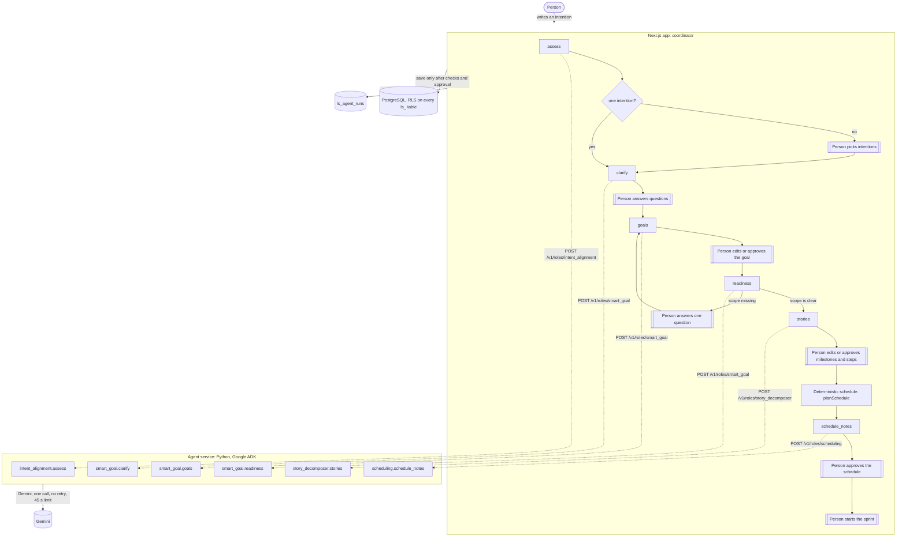
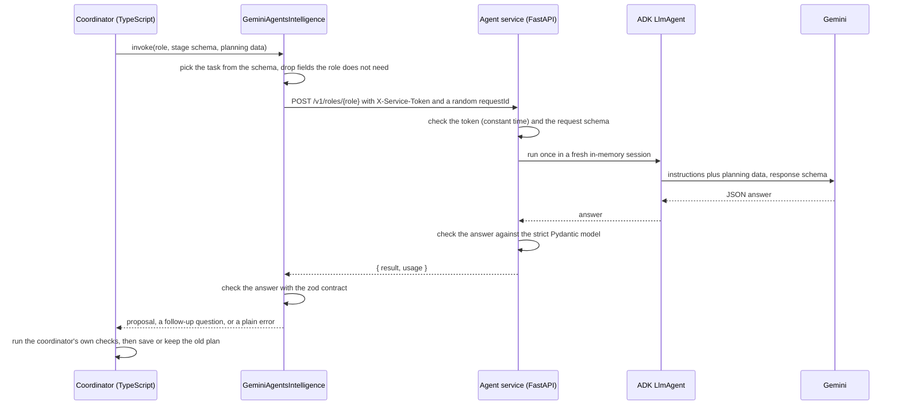

# LunarSprints agents (Step 3, Run 1)

The web app owns every decision. The agent service only proposes. Each proposal is checked twice (Pydantic in the service, then the zod contract and the coordinator's own rules in the app) before anything is saved, and only the person can approve it.

## Planning flow

Double brackets mark a checkpoint where the person decides. Nothing after a checkpoint runs until the person acts.

## One call, end to end

## Calls kept separate (no SequentialAgent yet)

| Back-to-back calls with no person in between | Decision | Why |
|---|---|---|
| intent_alignment.assess, then smart_goal.clarify (when there is one intention) | Separate | The app checks the intention ids are unique and decides whether the person must pick intentions first. |
| smart_goal.readiness, then story_decomposer.stories | Separate | The app checks the readiness answer first. If scope is missing it stops and asks the person, so no tokens are spent on steps that would be thrown away. |

A SequentialAgent would put both calls in one service request and skip the app's check between them. If a later run needs fewer round trips, the steps agent must be told to stop when readiness says scope is missing, and the app must still check both answers in order before saving.

## Roles not connected yet

daily_execution, adaptive_backlog and reflection return "AI suggestions are being upgraded. Your saved plan is safe." until Run 2. orchestrator and capacity are never called; rhythm is disabled.
